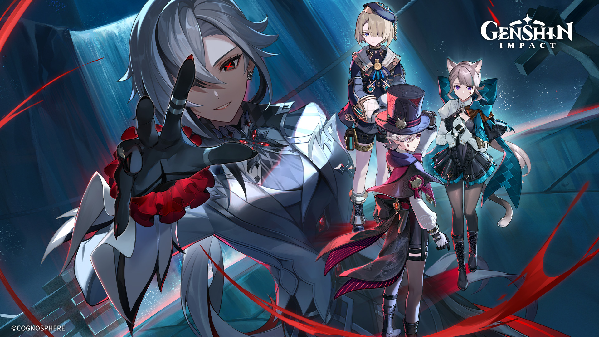
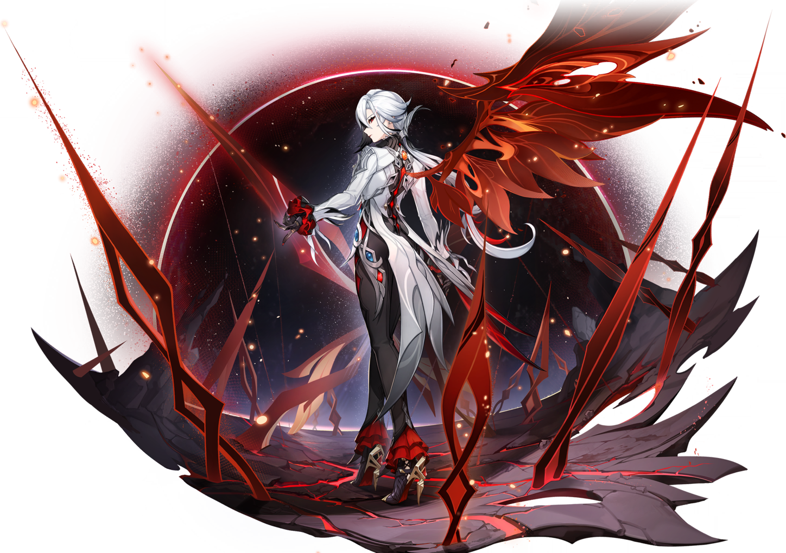

<!-- ======================================================== -->
<!-- ARLECCHINO • THE KNAVE | PROFILE README                 -->
<!-- EXECUTIVE DIRECTORATE OF THE HOUSE OF THE HEARTH        -->
<!-- ======================================================== -->

<div align="center">

<!-- HEADER WAVE SVG DINAMIS -->


<!-- TYPING ANIMATION CINZEL -->


<br/><br/>

<!-- BANNER UTAMA -->
<a href="https://github.com/FlashDIvine">
  
</a>

<br/><br/>

<blockquote>
  <p align="center">
    <em>"I will do my utmost to teach them how to navigate life. The House of the Hearth begs favors from no one — like a spider, we hunt for what we want."</em>
  </p>
</blockquote>

</div>

---

### 🩸 Tactical Dossier & Operative Directive

<table border="0" width="100%">
  <tr valign="middle">
    <td width="35%" align="center">
      
      <br/>
      <sub><b>Cinder of Two Worlds' Flames</b></sub>
    </td>
    <td width="65%">

```yaml
# ── TACTICAL DOSSIER: FOURTH HARBINGER DIRECTORATE ──
operative:
  codename: "The Knave (Arlecchino)"
  designation: "Lead Systems Operative / Fourth Harbinger Directorate"
  target_user: "FlashDIvine"
  allegiance: "House of the Hearth / Fatui Intelligence"
  status: "Operational"

domain:
  - "High-Performance Computing"
  - "Cloud Infrastructure"
  - "Zero-Trust Systems"

methodology:
  principles:
    - "Zero Technical Debt"
    - "Strict Type Safety"
    - "Sub-millisecond Latency"
  hearth_rule: "Errors and vulnerabilities are purged deterministically."
```

<div align="right">
  
</div>

  </td>
  </tr>
</table>

---

### ⚔️ Matriks Keahlian & Gudang Senjata

<div align="center">

#### Primary Weapons • Core Languages
<p align="center">
  
  
  
  
  
  
</p>

#### Tactical Gears • Infrastructure & Tools
<p align="center">
  
  
  
  
  
  
</p>

</div>

---

### 📊 Telemetri Kontribusi & Statistik Intelijen

<div align="center">

<table border="0" width="100%">
  <tr align="center">
    <td width="50%">
      
    </td>
    <td width="50%">
      
    </td>
  </tr>
</table>

<br/>

<!-- GITHUB STREAK STATS DENGAN CINCIN API MERAH -->


</div>

---

### 📡 Kanal Komunikasi & Encrypted Wire

<div align="center">

<p align="center">
  Instruksi strategis, pertukaran intelijen, atau koordinasi teknis dapat dikirim melalui jalur terenkripsi berikut:
</p>

<p align="center">
  <a href="mailto:emailkamu@gmail.com">
    
  </a>
  &nbsp;
  <a href="https://linkedin.com/in/FlashDIvine" target="_blank">
    
  </a>
  &nbsp;
  <a href="https://discord.com/users/FlashDIvine" target="_blank">
    
  </a>
</p>

<br/>

<!-- FOOTER WAVE SVG DINAMIS -->


</div>
